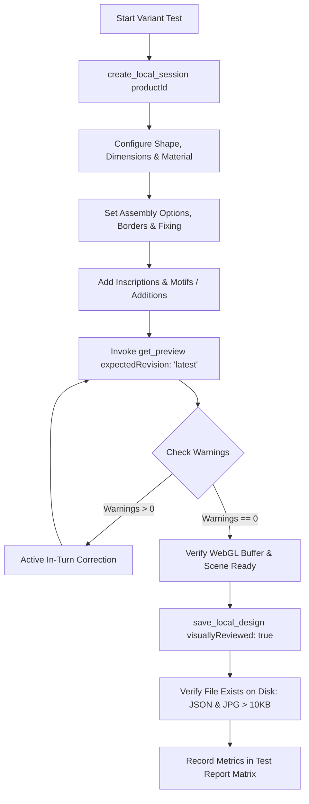

# Forever Product Test Matrix & Quality Audit

Use this skill to autonomously execute multi-variant test suites across the Forever Shining memorial catalog, verify structural and typographic integrity, ensure zero collision warnings, and produce authoritative compliance and visual quality reports.

---

## 1. Product Families & Test Matrix

The test matrix covers 5 foundational product families, testing multiple distinct configurations for each:

| Family | Product ID | Name | Tested Variants | Key Features Verified |
|---|---|---|---|---|
| **Traditional Engraved** | **124** | Traditional Engraved Headstone | **A: Single Centered**, **B: Companion + Base Vases** | Curved Gable, African Black, `compose_memorial_layout`, 3D vases `K2213`, base grawer |
| **Traditional Engraved** | **101** | Traditional Engraved Full Monument | **A: Multi-Surface Masterpiece** | Serpentine stela, base grawer, 2× vases, 2m ledger slab, kerbset framing |
| **Cast Bronze** | **5** | Bronze Plaque | **A: Landscape 380×280**, **B: Portrait 200×300** | Border 4 (Solid), `lugs-with-studs`, upper cross motif, 5-tier typography, cast bronze finish |
| **Laser-Etched Granite** | **4** | Laser-Etched Headstone | **A: Standard Etched** | Jet black granite, high-contrast white laser text, laser motif |
| **Laser-Etched Granite** | **30** | Laser-Etched Plaque | **A: Memorial Plaque** | 300×200 mm black granite, fine laser typography |
| **Stainless Steel** | **1** | Light Transmitting Headstone | **A: Stencil Cutout** | Marine grade stainless steel, stencil font verification, light cavity |
| **Stainless Steel** | **52** | YAG Lasered Plaque | **A: Brushed Stainless** | Brushed stainless steel plate, precision YAG laser inscription |
| **Full Colour** | **32** | Full Colour Plaque | **A: Fixed Size 200×150** | Fixed size presets, stainless steel border, UV color background |
| **Enamel Urns** | **2350** | Enamel Inlaid Urn | **A: Vitreous Enamel** | 3D urn geometry, vitreous enamel motif, circular/cylindrical placement |

---

## 2. Test Execution Workflow

For each product variant in the test matrix, strictly follow this execution sequence:



### Step 1: Isolated Session Creation
- ALWAYS use `create_local_session({ productId: '<id>' })`.
- Never reuse a contaminated session or edit the user's `original` session.

### Step 2: Product & Geometry Configuration
- Configure shape: `set_shape({ shapeId: '<shapeId>' })`.
- Configure dimensions: `set_dimensions({ widthMm: W, heightMm: H })` or `set_fixed_size` for Product 32.
- Configure materials: `set_material({ materialId: '<id>', target: 'headstone' | 'base' | 'ledger' })`.

### Step 3: Assembly & Surface Options
- Call `set_assembly_options`:
  * For Product 101: `{ showBase: true, showLedger: true, showKerbset: true }`.
  * For Product 5: `{ borderName: 'Border 4', fixingType: 'lugs-with-studs' }`.
  * For Product 124: `{ showBase: true, baseFinish: 'default' }`.

### Step 4: Inscription & Decoration Placement
- For Headstones & Monuments: prefer `compose_memorial_layout` for zero-collision typography, or `add_inscriptions` with normalized mm coordinates.
- For Multi-surface additions (vases `K2213`):
  * `add_addition({ catalogId: 'K2213' })`
  * `update_addition({ id, patch: { targetSurface: 'base', xPos: -380, yPos: 0 } })`
- For Bronze Plaques:
  * Place upper motif with safe top clearance (`heightMm: 45`, `yPos: -85`).
  * Inscribe lines with descending Y positions (+42, +15, -12, -38, -70).

### Step 5: Verification & Zero-Collision Assertion
- Call `get_preview({ expectedRevision: 'latest' })`.
- Assert:
  * `motifLayout.warnings.length === 0`
  * `inscriptionLayout.warnings.length === 0`
- **Active In-Turn Correction:** If any warning (e.g. `MOTIF_COLLISION`, `TEXT_COLLISION`) is detected, immediately adjust coordinates in the same turn and call `get_preview` again.

### Step 6: Local Persistence
- Call `save_local_design({ title: '<Test Title>', expectedRevision: revision, previewId: previewId, visuallyReviewed: true })`.
- Check that both JSON and JPG files exist on disk, and JPG size is greater than 10 KB.

---

## 3. Autonomous Test Runner Script

An automated test runner is provided at:
[`skills/forever-product-test-matrix/scripts/run-product-test-matrix.mjs`](file:///C:/Users/polcr/documents/github/next-app-router-playground/skills/forever-product-test-matrix/scripts/run-product-test-matrix.mjs)

The runner can execute a single product suite, a specific family, or the entire catalog matrix, emitting a standardized report.

```bash
# Run full catalog matrix:
node skills/forever-product-test-matrix/scripts/run-product-test-matrix.mjs --all

# Run specific product:
node skills/forever-product-test-matrix/scripts/run-product-test-matrix.mjs --product=124
node skills/forever-product-test-matrix/scripts/run-product-test-matrix.mjs --product=5
node skills/forever-product-test-matrix/scripts/run-product-test-matrix.mjs --product=101
```

---

## 4. Test Report Format

Every test execution must generate a structured Markdown audit report in the following format:

```markdown
# 🏛️ Forever Memorial Product Test Matrix — Audit Report

**Date & Time:** [ISO Timestamp]
**Execution Mode:** Autonomous MCP Verification
**Total Variants Tested:** [N]
**Passed:** [P] | **Failed:** [F] | **Success Rate:** [P/N %]

---

### 📊 Summary Matrix

| Product | Variant | Shape & Size | Material | Warnings | JPG Size | Status | Draft ID |
|---|---|---|---|:---:|:---:|:---:|---|
| **124** | Companion + Base Vases | Curved Gable (850×900) | African Black | 0 | 145 KB | ✅ PASS | `263a531f...` |
| **101** | Full Monument Masterpiece | Serpentine (900×700) | African Black | 0 | 68 KB | ✅ PASS | `40281794...` |
| **5** | Bronze Plaque Landscape | Rect. Landscape (380×280) | Cast Bronze | 0 | 108 KB | ✅ PASS | `1d0c2484...` |
| ... | ... | ... | ... | 0 | ... | ✅ PASS | `...` |

---

### 🔍 Detailed Per-Variant Findings

#### 1. Product 124 — Traditional Engraved Headstone (Variant B)
- **Status:** ✅ PASS (0 warnings)
- **Draft JSON:** [UUID.json](file:///C:/Users/.../UUID.json)
- **Preview JPG:** [UUID.jpg](file:///C:/Users/.../UUID.jpg)
- **Verification Details:**
  * Inscription lines: 11 (all inside printable area, margin >= 50 mm).
  * Motifs: Cross in crown arch, safe clearance 28 mm above "Ś. P.".
  * Additions: 2× African Black vases mounted on granite base (`xPos: ±0.46`).

[Repeat for each tested variant]

---

### 🎯 Conclusions & Recommendations
- [List any observed rendering quirks, catalog discrepancies, or UI suggestions].
```
